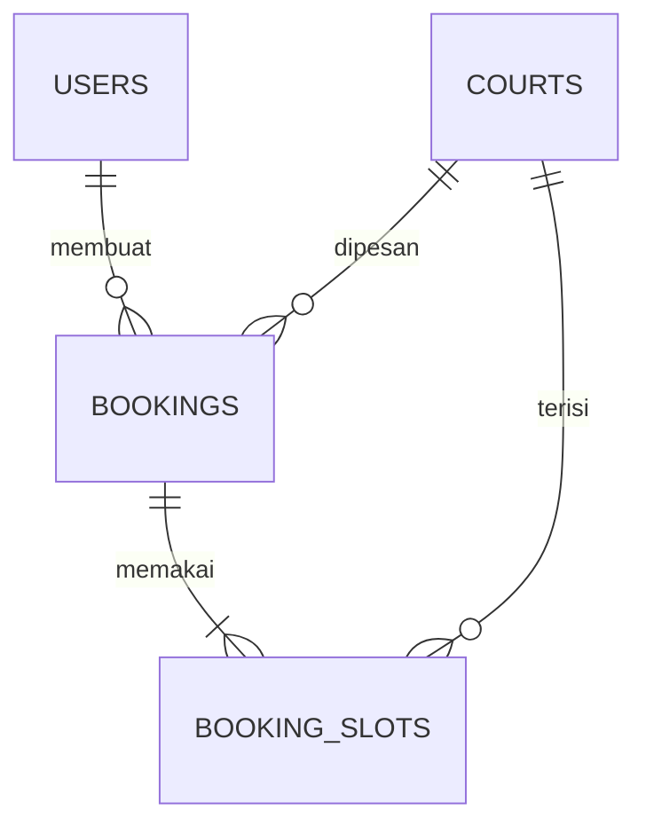

# Padel Booking

Aplikasi booking lapangan padel: pilih tanggal, pilih jam, bayar, lihat riwayat pesanan.
Dibangun dengan Java dan Spring Boot sebagai project portofolio backend.

> Status: **dalam pengerjaan**. Fondasi database dan model sudah selesai, fitur login dan booking sedang dibangun.

## Fitur inti yang direncanakan

- Register dan login dengan dua peran: `USER` dan `ADMIN`
- Pilih tanggal (kalender) dan jam lewat grid slot
- Tahan slot sementara 10 menit saat checkout (hold), lalu kedaluwarsa otomatis
- Pembayaran simulasi: sukses, gagal, atau kedaluwarsa
- Halaman "Booking Saya" untuk user
- Halaman admin: riwayat transaksi (15 data per halaman), hari libur, laporan keuangan per bulan dengan ekspor CSV
- Nomor WhatsApp user disamarkan di halaman admin, dengan audit log saat dibuka

## Teknologi

| Bagian           | Pilihan                                                   |
| ---------------- | --------------------------------------------------------- |
| Bahasa           | Java 25                                                   |
| Framework        | Spring Boot 4.1 (Web MVC, Data JPA, Validation, Actuator) |
| Database         | MariaDB / MySQL                                           |
| Migrasi database | Flyway                                                    |
| Build            | Maven (wrapper `mvnw` disertakan)                         |
| Tes              | JUnit 5 + Spring Boot Test                                |

## Desain database



### Mencegah double booking

Tabel `booking_slots` punya aturan `UNIQUE (court_id, play_date, slot_hour)`.
Jadi, sekalipun dua orang memesan jam yang sama di detik yang sama, **database sendiri
yang menolak** pesanan kedua. Pengecekan di kode Java saja tidak cukup untuk kondisi balapan.
Perilakunya dibuktikan oleh tes `DoubleBookingTest`.

Aturan lain di tingkat database: `UNIQUE` pada email, `FOREIGN KEY` antar tabel,
dan `CHECK` pada kolom status, peran, dan metode pembayaran.

## Cara menjalankan

Kebutuhan: JDK 25 dan MariaDB/MySQL (misalnya dari XAMPP).

1. Nyalakan MySQL, lalu buat database kosong:

   ```sql
   CREATE DATABASE padel_booking CHARACTER SET utf8mb4;
   ```

2. Sesuaikan `spring.datasource.username` dan `spring.datasource.password`
   di `src/main/resources/application.properties` kalau berbeda dengan pengaturan lo.

3. Jalankan aplikasi. Flyway akan membuat semua tabel dan data lapangan awal secara otomatis:

   ```
   ./mvnw spring-boot:run
   ```

4. Coba di browser:
   - `http://localhost:8080/api/courts` menampilkan daftar lapangan
   - `http://localhost:8080/actuator/health` menampilkan status aplikasi dan database

## Menjalankan tes

```
./mvnw test
```

## Struktur folder

```
src/main/java/com/padelarena/padel_boking
├── controller    pintu masuk web (REST)
├── model         kelas yang mewakili tabel
└── repository    akses ke database
src/main/resources/db/migration   skrip SQL Flyway
```

## Rencana pengerjaan

- [x] Database dan migrasi Flyway
- [x] Model dan repository
- [x] Tes anti double booking
- [ ] Register dan login (Spring Security, BCrypt, JWT)
- [ ] Slot, hold, dan pembuatan booking
- [ ] Pembayaran simulasi dan kedaluwarsa otomatis
- [ ] Fitur admin: riwayat, hari libur, laporan CSV
- [ ] Sambungkan tampilan web
- [ ] Docker dan CI
